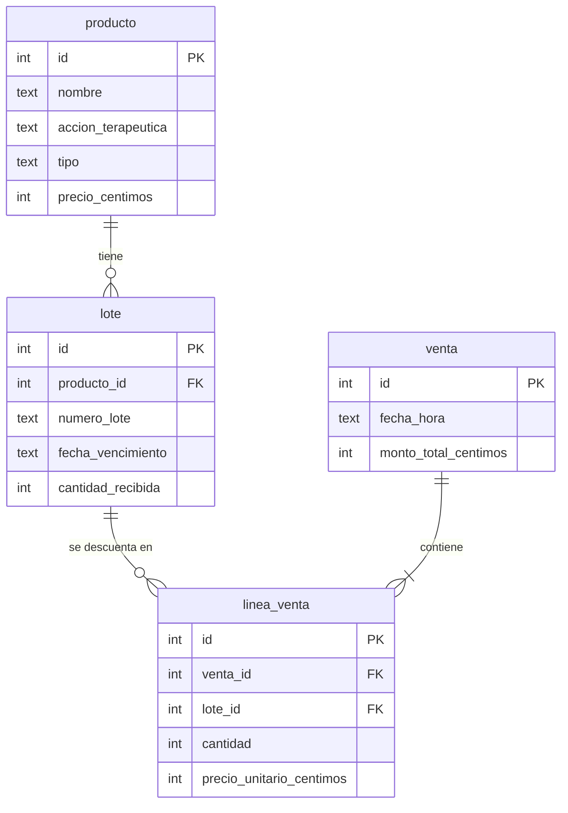

# Modelo de datos

Todo precio y cantidad va por unidad. Los precios se guardan en céntimos enteros (S/ 0.50 = 50).

El stock de un lote es `cantidad_recibida` menos la suma de `linea_venta.cantidad` de ese lote.
La restricción `UNIQUE (producto_id, numero_lote)` evita registrar dos veces el mismo lote de un producto (HU-05).
