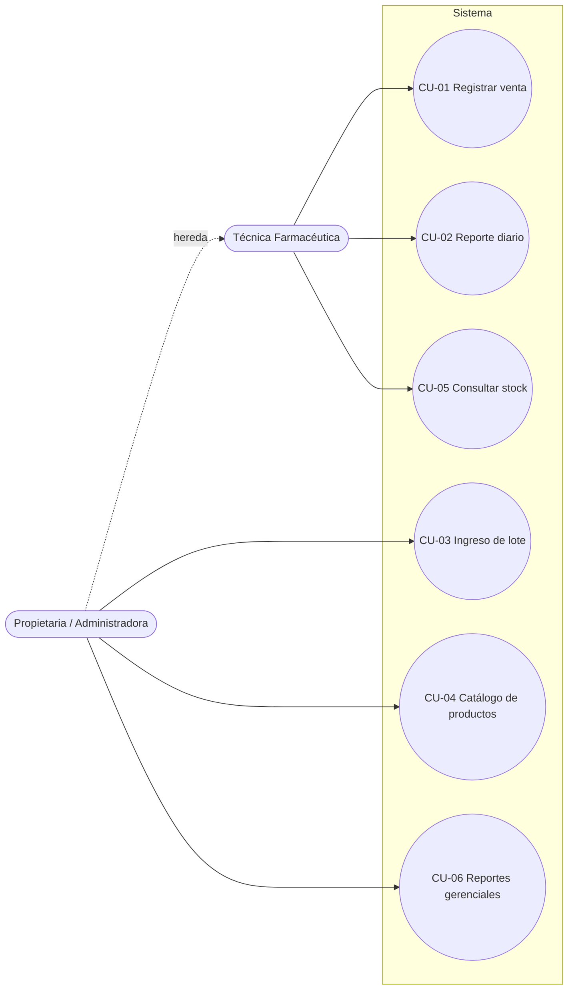

# 06 — Casos de uso

## Actores

- **Técnica Farmacéutica**: actor principal de ventas y consultas.
- **Propietaria / Administradora**: especialización de la técnica; hereda sus casos de uso y tiene los propios.

## Resumen

| ID | Caso de uso | Actor principal | Requisitos |
|---|---|---|---|
| CU-01 | Registrar venta | Técnica Farmacéutica | RF-01, RF-02, RF-03 |
| CU-02 | Consultar reporte diario de ventas | Técnica Farmacéutica | RF-04 |
| CU-03 | Registrar ingreso de lote | Propietaria | RF-05, RF-06 |
| CU-04 | Gestionar catálogo de productos | Propietaria | RF-07, RF-08, RF-09 |
| CU-05 | Consultar stock | Técnica Farmacéutica | RF-10 |
| CU-06 | Generar reportes gerenciales | Propietaria | RF-11 |

Relaciones:

- CU-01 **«include»** Descontar stock por lote más próximo a vencer.
- CU-03 **«include»** Validar duplicidad de lote.
- Registrar producto nuevo **«extend»** CU-03 (cuando el producto que llega aún no está en el catálogo).

## Ficha del caso de uso principal: CU-01 Registrar venta

| Campo | Detalle |
|---|---|
| Actor principal | Técnica Farmacéutica |
| Actor secundario | Propietaria (por herencia) |
| Disparador | Un cliente solicita uno o más productos en el mostrador. |
| Precondiciones | 1. El sistema está en ejecución en la laptop. 2. Los productos están en el catálogo y tienen al menos un lote con stock. |
| Postcondiciones (éxito) | La venta queda registrada (fecha, hora, productos, cantidades, monto); el stock de cada lote usado disminuye; la venta aparece en el reporte diario. |
| Postcondiciones (fallo) | No se registra la venta y el stock no cambia. |

**Flujo principal**

1. La técnica inicia una nueva venta.
2. Busca el producto por nombre o categoría.
3. El sistema muestra los productos coincidentes con precio y stock disponible.
4. La técnica selecciona el producto e ingresa la cantidad.
5. El sistema verifica que el stock total de los lotes disponibles cubra la cantidad.
6. El sistema agrega la línea y actualiza subtotal y total.
7. Se repiten los pasos 2 a 6 por cada producto.
8. La técnica confirma la venta.
9. El sistema descuenta el stock empezando por el lote con vencimiento más próximo.
10. El sistema registra la venta.
11. El sistema muestra la confirmación con el monto a cobrar.

**Flujos alternativos**

- **A1 — Producto no encontrado (paso 3):** se informa que no hay coincidencias; registrar productos nuevos corresponde a la propietaria (CU-04).
- **A2 — Stock insuficiente (paso 5):** se muestra la cantidad disponible y no se acepta una mayor.
- **A3 — Modificar o quitar una línea (antes del paso 8):** se recalcula el total.
- **A4 — Cancelar la venta (antes del paso 8):** se descarta sin modificar el stock.

**Excepciones**

- **E1 — Error al registrar (paso 10):** se informa el error, no se descuenta stock y se conservan las líneas para reintentar.

**Reglas de negocio**

- **RN-01:** el stock se descuenta primero del lote con fecha de vencimiento más próxima (pendiente de validar).
- **RN-02:** una venta tiene al menos una línea y cada cantidad es mayor que cero.
- **RN-03:** monto total = Σ (cantidad × precio unitario vigente).
- **RN-04:** el cobro y la boleta se hacen en el POS, fuera del sistema.
